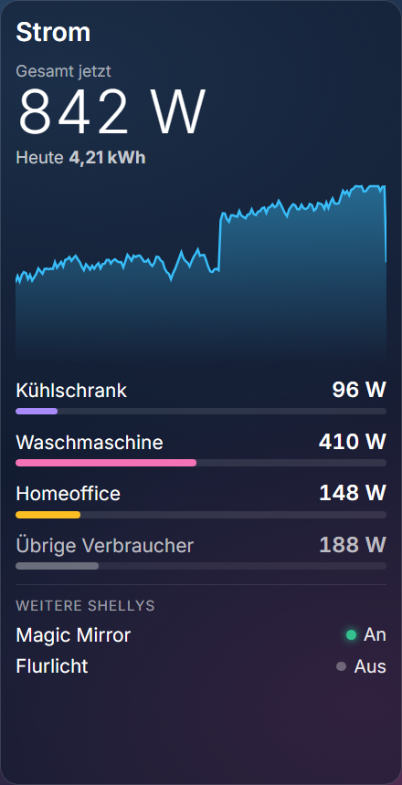

# Stromverbrauch (Shelly) · Power Consumption (Shelly)

**[Deutsch](#deutsch) · [English](#english)** · Plugin für / for [Home Screens](https://github.com/home-screens/home-screens) · v0.2.1

<p align="center"></p>

## Deutsch

Zeigt den **aktuellen Stromverbrauch deiner Wohnung** aus Shelly-Messgeräten im lokalen Netz: Gesamtleistung groß mit Verlauf, Verbrauch seit Mitternacht, Einzelverbraucher mit Balken und – unten – den Schaltzustand von Shellys ohne Messung.

### Was kann das Plugin?

- Gesamtleistung groß („842 W“, ab 1000 W „1,24 kW“) mit Verlauf der letzten ~30 Minuten
- Verbrauch **seit Mitternacht** in kWh
- Einzelverbraucher mit Balken + **„Übrige Verbraucher“** (Gesamt minus Einzelwerte)
- **„Weitere Shellys“:** An/Aus-Zustand von Geräten ohne Leistungsmessung (Shelly 1, Plus 1 …)
- Unterstützt **Gen1** (z. B. Shelly EM, 1PM) und **Gen2/Plus/Pro** (z. B. Plus PM Mini)

### Installation – Schritt für Schritt

**Voraussetzung:** Du hast Home Screens bereits laufen (Server erreichbar im Browser).

1. Öffne den **Editor** deines Home-Screens-Servers im Browser an einem Computer (nicht am Handy; er braucht mindestens 768 Pixel Breite). Die Adresse ist meist `http://<Adresse-deines-Servers>:3000/editor`.
2. Klicke oben in der Leiste auf **Plugins** (neben „Einstellungen“ und „Vorschau“).
3. Klicke auf **Aus URL installieren …**.
4. Füge im Feld **Tarball-URL** diesen Link ein und klicke auf **Installieren**:

   ```
   https://github.com/Gyrosguenter/home-screens-plugin-shelly/releases/latest/download/shelly-power.tar.gz
   ```

   Home Screens weist darauf hin, dass das Plugin „nicht vom Home-Screens-Team geprüft“ ist. Das ist normal, denn es stammt nicht aus dem Marktplatz. Du siehst eine Übersicht, was das Plugin darf.
5. Warte, bis die Installation fertig ist, und klicke auf **Fertig**. Falls das Modul nicht sofort in der Liste auftaucht, lade die Seite neu (F5).
6. Ziehe das Modul auf den Bildschirm: Links in der Liste **MODULE** (Hinweis „Auf den Bildschirm ziehen“) findest du unter **SMART HOME** das Modul **Stromverbrauch (Shelly)** (mit der Markierung „Plug-in“). Ziehe es auf deinen Bildschirm und passe Größe und Position an.
7. Klicke das Modul an: rechts erscheinen die **Einstellungen**. Der Editor **speichert automatisch**, einen Speichern-Knopf gibt es nicht.

### Beispiel für „Geräte“

```
Gesamt | 192.168.1.20 | 1
Kühlschrank | 192.168.1.21
Waschmaschine | 192.168.1.22
Homeoffice | 192.168.1.23
Flurlicht | 192.168.1.25
```

**IP-Adresse eines Shelly finden:** in der Shelly-App unter *Geräteinformationen*, oder im Router bei den verbundenen Geräten. Tipp: Im Router für die Shellys eine **feste IP-Adresse (DHCP-Reservierung)** vergeben, sonst ändert sich die Adresse irgendwann.

**Welcher Kanal beim Shelly EM?** Er hat zwei Messkanäle (Klemmen). Je nach Anschluss hängt dein Verbraucher an Kanal `0` oder `1`. Probiere beide, die falsche Zeile zeigt „0 W“.

### Einstellungen

| Einstellung | Bedeutung |
|---|---|
| Titel | Überschrift des Moduls, z. B. `Strom`. |
| Geräte | Eine Zeile je Gerät: `Name | IP-Adresse | Kanal`. Der Kanal ist nur bei Geräten mit mehreren Messkanälen nötig (z. B. Shelly EM). **Die erste Zeile ist der Gesamtverbrauch**, alle weiteren werden darunter gezeigt. Geräte ohne Messung landen automatisch unter „Weitere Shellys“. |
| Aktualisierung (ms) | 5 000–60 000, Standard 10 000 (10 Sekunden). |

### Aktualisieren

Wiederhole einfach die Installation mit **demselben Link** (Schritte 2–4). Er zeigt immer auf die neueste Version; deine Einstellungen bleiben erhalten.

### Hilfe bei Problemen

- **Zeigt „–“ statt eines Werts?** Das Gerät ist von deinem Home-Screens-Server aus nicht erreichbar (falsche IP, Gerät offline, anderes Netz/VLAN) oder hat ein Passwort gesetzt. **Geräte mit Passwort werden nicht unterstützt.**
- **Tagesverbrauch fehlt?** Er erscheint erst, wenn der Browser des Displays eine Weile gemessen hat (30 Minuten nach der ersten Messung, bzw. ab Mitternacht ganz genau).
- **Installation schlägt fehl?** Dein Home-Screens-Server muss auf `github.com` zugreifen können (Internet). Prüfe, ob der Link vollständig kopiert wurde.
- **Modul bleibt leer nach dem Ziehen?** Seite neu laden (F5). Ein paar Sekunden warten, manche Module laden Daten erst nach dem Einfügen.

### Datenschutz und Hinweise

Der Home-Screens-Server fragt deine Shellys im lokalen Netz ab (Zugriffe laufen über den Server-Proxy, weil der Browser des Displays lokale HTTP-Adressen nicht ansprechen darf). Dafür deklariert das Plugin die Berechtigung `localNetwork` und die erlaubten Adressen `*`: Der Proxy darf damit beliebige Adressen im Netz erreichen – **das Plugin fragt aber ausschließlich die Adressen ab, die du unter „Geräte“ einträgst.** Verlauf und Tageszähler speichert der Browser des Displays lokal (`localStorage`); es gibt keine Cloud.

---

## English

Shows your **household's current power consumption** from Shelly meters on your local network: total power with history, consumption since midnight, individual consumers with bars and – at the bottom – the on/off state of Shellys without metering.

### What does it do?

- Total power shown large ("842 W", "1.24 kW" above 1000 W) with history of the last ~30 minutes
- Consumption **since midnight** in kWh
- Individual consumers with bars + **"Other consumers"** (total minus individual values)
- **"More Shellys":** on/off state of devices without power metering (Shelly 1, Plus 1 …)
- Supports **Gen1** (e.g. Shelly EM, 1PM) and **Gen2/Plus/Pro** (e.g. Plus PM Mini)

### Installation – step by step

**Prerequisite:** Home Screens is already running (server reachable in the browser).

1. Open the **editor** of your Home Screens server in a browser on a computer (not a phone; it needs at least 768 pixels width). The address is usually `http://<address-of-your-server>:3000/editor`.
2. Click **Plugins** in the top bar (next to "Settings" and "Preview").
3. Click **Install from URL…**.
4. Paste this link into the **Tarball URL** field and click **Install**:

   ```
   https://github.com/Gyrosguenter/home-screens-plugin-shelly/releases/latest/download/shelly-power.tar.gz
   ```

   Home Screens warns that the plugin "has not been reviewed by the Home Screens team". That is normal because it does not come from the marketplace. You will see an overview of what the plugin may do.
5. Wait until the installation has finished and click **Done**. If the module does not show up in the list immediately, reload the page (F5).
6. Drag the module onto the screen: in the **MODULES** list on the left ("Drag onto the screen") find **Stromverbrauch (Shelly)** under **SMART HOME** (marked "Plugin"). Drag it onto your screen and adjust size and position.
7. Click the module: the **settings** appear on the right. The editor **saves automatically**; there is no save button.

### Example for "Devices"

```
Total | 192.168.1.20 | 1
Fridge | 192.168.1.21
Washing machine | 192.168.1.22
Home office | 192.168.1.23
Hall light | 192.168.1.25
```

**Finding a Shelly's IP address:** in the Shelly app under *Device information*, or in your router's list of connected devices. Tip: give the Shellys a **fixed IP address (DHCP reservation)** in your router, otherwise the address will change eventually.

**Which channel on a Shelly EM?** It has two metering channels (clamps). Depending on your wiring your load is on channel `0` or `1`. Try both; the wrong one shows "0 W".

### Settings

| Setting | Meaning |
|---|---|
| Title | Heading of the module, e.g. `Power`. |
| Devices | One line per device: `Name | IP address | channel`. The channel is only needed for devices with several metering channels (e.g. Shelly EM). **The first line is the total consumption**, the others are shown below. Devices without metering automatically go under "More Shellys". |
| Refresh (ms) | 5,000–60,000, default 10,000 (10 seconds). |

### Updating

Simply repeat the installation with the **same link** (steps 2–4). It always points to the latest version; your settings are kept.

### Troubleshooting

- **Shows "–" instead of a value?** The device is not reachable from your Home Screens server (wrong IP, device offline, other network/VLAN) or has a password set. **Devices with a password are not supported.**
- **Daily consumption missing?** It appears only after the display's browser has been measuring for a while (30 minutes after the first reading, exact from midnight).
- **Installation fails?** Your Home Screens server must be able to reach `github.com` (internet). Check that the link was copied completely.
- **Module stays empty after dragging?** Reload the page (F5). Wait a few seconds; some modules fetch data only after being added.

### Privacy and notes

Your Home Screens server queries your Shellys on the local network (requests go through the server proxy because the display's browser may not address local HTTP addresses). For this the plugin declares the `localNetwork` permission and the allowed addresses `*`: the proxy may therefore reach any address on your network – **but the plugin only queries the addresses you enter under "Devices".** History and daily counter are stored locally in the display's browser (`localStorage`); there is no cloud.

---

## Technik / Technical notes

- **ID / Manifest:** `shelly-power` – Version 0.2.1, License MIT
- Bauen / Build: `npm install && npm run build && npm test`
- Release-Archiv für die Installation / Release archive used for installation: `shelly-power.tar.gz` (enthält / contains `shelly-power/manifest.json` + `shelly-power/dist/bundle.js`)
- Teil eines privaten Heim-Projekts (Magic-Mirror-Ersatz); als eigenes öffentliches Repo geführt, damit die Installations-URL ohne Anmeldung erreichbar ist / Part of a private home project (Magic Mirror replacement); kept as its own public repo so the install URL works without login.
- Dieses Plugin ist ein inoffizielles Community-Plugin und steht in keiner Verbindung zum Home-Screens-Team / This is an unofficial community plugin and is not affiliated with the Home Screens team.

MIT
